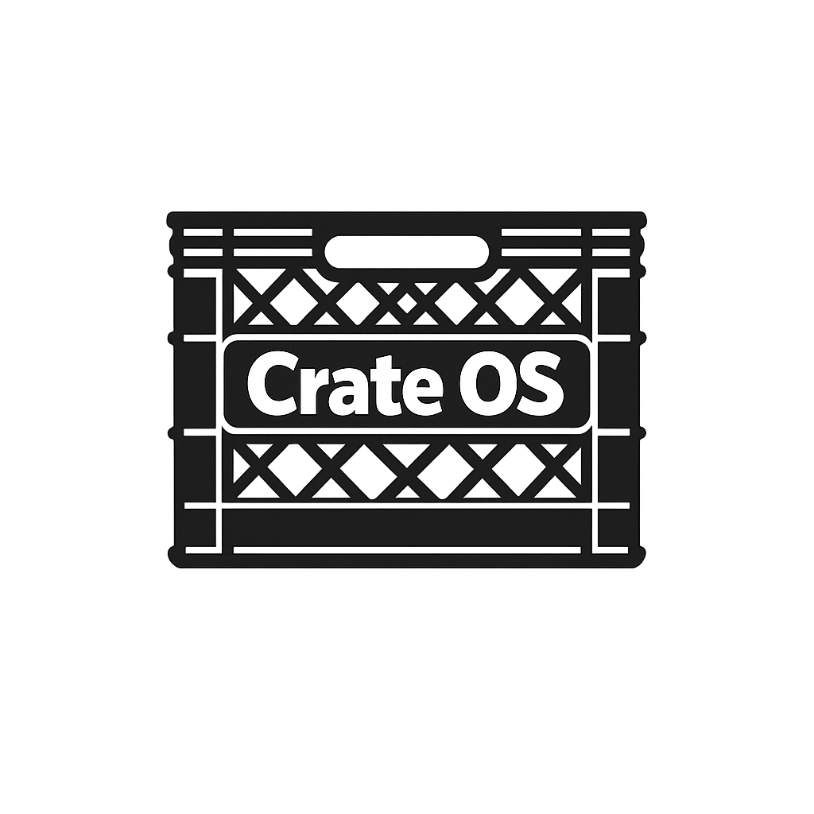

<div align="center">



# Crate OS DJ Edition

### Your music library, your crates, and GOOD MIXX in one Mac app.

From **XTRA GOOD LABS** · [**Buy me a coffee ☕**](https://buymeacoffee.com/xtragoodlabs) · [**Website**](https://xtragoodlabs.github.io/crate-os/) · [**Download for Mac**](https://github.com/XTRAGOODLABS/crate-os/releases/download/v0.2.0-beta.1/Crate-OS-DJ-Edition-0.2.0-beta.1-macOS-arm64.zip) · [**Changelog**](CHANGELOG.md) · [**Troubleshooting**](TROUBLESHOOTING.md)

</div>

Crate OS is a local-first macOS music-library and DJ workflow application built with Tauri 2, React, TypeScript, Rust, SQLite, and the bundled GOOD MIXX sidecar.

GOOD MIXX is based on an original idea by **DJ Aquarobotics**.

Version: `0.2.0-beta.1`

## Features

- Local music-library scanning, metadata review, SQLite persistence, and recoverable tag writes.
- A Crate Builder for searching the scanned library, arranging tracks in play order, and saving named M3U8 or CSV playlists.
- CSV, DJ-prep CSV, M3U8, and JSON exports.
- The user-updated GOOD MIXX interface and behavior: LIVE decks, automatic djay or Traktor tracking, GOOD MIX, WHAT'S NEXT, BPM/Camelot/energy suggestions, REVIEW A SET, MY MIXES, and saved transition memory.
- Optional protected LAN access for an iPad or Meta Portal.
- No Python installation, Terminal window, Live365 account, or running djay session is required for the app itself.

## Development

Requirements: Node.js 22+, Rust stable, and Python 3 for building the bundled sidecar.

```sh
npm install
npm run test:dj-mixes
npm run dj-mixes:build
npm run build
cargo test --manifest-path src-tauri/Cargo.toml
npm run tauri:dev
```

Build a macOS application for the current architecture:

```sh
npm run dj-mixes:build
npm run tauri:build:app
```

The sidecar builder names its output for the current Rust target. Build Apple Silicon on an arm64 Mac and Intel on an Intel runner. The repository workflow uses `macos-15` and `macos-15-intel` jobs.

## Data and migration

Crate OS stores its database and GOOD MIXX data under the macOS application-support directory for `labs.xtragood.crate-os`. It never bundles or publishes a user's library, mixes, or audio.

On first GOOD MIXX start, files are copied from `~/Portal-Stems-FX/data` only when the matching destination does not already exist. The toolbar also exposes the same non-destructive import explicitly.

## Networking and permissions

Crate OS's bundled GOOD MIXX binds to `127.0.0.1:18770` by default so it can coexist with a standalone GOOD MIXX installation on 8770. **Enable iPad / Portal** restarts it on the LAN with a generated token. The token is exchanged for an HttpOnly, SameSite cookie before the interface loads.

Reading djay history is read-only. Reading keys displayed on djay decks additionally needs macOS Accessibility permission for Crate OS.

## Radio publishing

Radio station (Live365) publishing tools are not part of this repository. Crate OS writes a Live365-ready CSV export and keeps each track's readiness label, but never signs in to or publishes to Live365.

## Release status

See [RELEASE-NOTES-v0.2.0-beta.1.md](RELEASE-NOTES-v0.2.0-beta.1.md), [CHANGELOG.md](CHANGELOG.md), and [TROUBLESHOOTING.md](TROUBLESHOOTING.md). Local compilation is distinct from Apple code signing and notarization.

## Support

If Crate OS or GOOD MIXX helps your sets, you can [buy XTRA GOOD LABS a coffee](https://buymeacoffee.com/xtragoodlabs).

## Credits

GOOD MIXX is based on an original idea by **DJ Aquarobotics**. Thanks to ckryptickunal's
[djay-pro-mcp](https://github.com/ckryptickunal/djay-pro-mcp) for inspiration. Traktor link based on
[traktor-api-client](https://github.com/ErikMinekus/traktor-api-client) by Erik Minekus (MIT). Fonts: IBM Plex (OFL).
See [THIRD-PARTY-NOTICES.md](THIRD-PARTY-NOTICES.md). Built by XTRA GOOD LABS with Codex and Claude.

Project code is not yet under an open-source license; all rights reserved until one is chosen.
